# Текущий порядок работ — 20 октября, 03:10 МСК

1. Три локальных Docker-образа и их содержимое приняты. Проверка HTTP с новой PostgreSQL следующая; загрузка образа БД идёт напрямую с полной сверкой manifest/config/layers после сетевых отказов Docker pull.
2. Затем настоящий upload/очередь: отдельный локальный контур, рабочий ClamAV, свежий синтетический PDF. Успех transport не заменяет проверку инженерных выводов.
3. Офлайн-калибровочный инструмент принят с23синтетическими тестами. Реальных независимых меток нет; текущие вероятности не активируются.
4. Один оставшийся composite gap исследуется отдельно. Добавление проверки возможно при наличии полных типизированных операндов и независимого эталона.
5. Подготовить полный локальный пакет запуска и материалы сдачи. Текущий ZIP содержит только контекст сборки и материалы ревью.

Homeserver отложен по последнему указанию пользователя; периодических SSH-проверок нет. Browser SECURITY_HOLD сохраняется. Актуальная сводка: [CURRENT_ACCEPTANCE_20261019.md](CURRENT_ACCEPTANCE_20261019.md). Записи ниже — исторический журнал.

## 19.10 15:39 МСК — обычный homeserver CPU PASS, сервисы сохранены

- Пользователь подтвердил восстановление доступа и разрешил продолжение на homeserver; heartbeat `inspector-ai-homeserver` удалён штатным automation tool. SSH доступен. Первая metadata-попытка после восстановления поймала реальную ошибку Docker template для отсутствующего optional `Health`; исправлено только чтение через safe map index. Все26 прежних ID/images/running/health подтверждены, jobs/runs/leases0, MemAvailable2970776KiB. Исходные отказы сохранены.
- Genuine ordinary-host semantic capacity PASS: `output/matrix-t83-20261018/ordinary-capacity/transport-v5-order-fixed/actual-first-receipt.json`, SHA `1fd87a91e4c16d90ed9553eb3eedf3a3fbae111f46e3ab3de8295f26560798c5`. Полный настоящий v12 dispatch + column evidence replay +11 whole hashes,41.799s/CPU41.993s/maxRSS275804KiB, bootstrap42.123s. Пределы55CPU/60wall/512MiB и available-memory gate1.5GiB прежние; GPU/networkAPI0. Temporary removed, independent own-dir absence verified.63scalar/70outputs/62partial parameters/70atoms/70unsupported — результаты этого тестового input, realQualifiedPairs0, не новое подтверждение реальных пар или calibration.
- Остановка сервисов не понадобилась: памяти достаточно. Fresh before/after26 whole metadata rows exact, API/web/relay healthy, jobs0. ROOT preservation receipt `24ed830b304f1e8a5f0ea916ee1113e4900541a7fa4e70146611a9c16c75e0c3` в `capacity-diagnosis/availability-after-ordinary-capacity-v1/root-no-service-mutation-preservation.json`. Lifecycle mutations0; restoration не выполнялась и не объявлена PASS. Новый aggregate-v5 сохраняет semantic gates и добавляет явную no-service-mutation ветку; приёмка aggregate ещё pending. Стенд остаётся T81v11.
- Shared budget V3 independent consumer проверен ROOT по исходникам/535pins, сейчас выполняется один local noEmit +mock1 +real PostgreSQL4 в собственной disposable DB. No full-v13/runtime/release authority. Target/review и steel admission source продолжаются; browser HOLD прежний.

## 19.10 15:30 МСК — локальный composer V3 noEmit PASS; SSH закрыт

- После истечения пятичасового окна выполнена одна bounded metadata-only SSH-попытка: exit255, `Connection closed by 192.168.31.175 port 22`, 11:19:28UTC. Никаких сервисных изменений/semantic calls, свежего baseline или ordinary-host acceptance нет. Outcome: `output/matrix-t83-20261018/capacity-diagnosis/owned-runtime-isolation-v6-order-fixed/availability-read-outcome.json`. Автоматического повтора нет; локальная реализация продолжается.
- Composer V3: полная настоящая проверка типов API+contracts PASS, outcome `98aa048b790b2ce68b5c7a317b32258120ebabdfe190a81231869ae9773faa4d`;6.180s/592064512B BUILD_ONLY,469 private copies, исходные/proposal pins exact, cleanup. Исправлены строгая типизация length descriptor и структурная копия WallFact; charge после inspection/run locks закрывает найденную статически гонку с completion. Оба scalar profile probe ограничены2 строками; настоящие конструкторы сохраняют ровно1 RULE slot, включая unconfigured source audit. Runtime race ещё не доказан PG-тестом.
- Shared budget V3/source-address source готовы; реальные PG budget tests готовятся. Public targets/review и pre-run steel resource seam реализуются в отдельных узких пакетах. Capsule/config остаются null до genuine accepted base; новые исходники output-only. Browser HOLD прежний; CLI/SSR не заменяют browser proof.

## 19.10 13:48 МСК — T85 guarded worker integration source prepared

- Prepared complete guarded worker release/SEAL source proposal, ready `232e973609e9058666b60bb3bd2aa24828d9d0ca47d3c631e7c0d402c6515c0c` in `output/matrix-t85-20261019/durable-worker-integration-v1/`. Own wrapper `90fa21d50f0734662d0c3757443d6bf915880fe82b3d56a4432401377ad475c4`, actual tested Python-v5 scalar, unchanged five selected leaves, tested main/pilot transport copies. Eight ASTs pass; inherited v12 validation body reverse AST exact, real HTTP loader and eight-domain execution body AST exact. These static checks do not prove execution.
- Explicit before-code amendment permits source preparation before genuine T83 base acceptance. Finite history-v3 capsule contract fixed: three unchanged v2 rows plus accepted v12 row, exact4 row keys; byte-identical API/worker resource, fixed2MiB resource read cap. Accepted capsule/config pins remain null; resource is absent; own v13 RULE/SEAL cannot execute. No fake capsule or accepted config generated.
- Preserved two ROOT static construction defects before freeze: selected metadata instead of closedLeafBlueprint; token transform also prefixed attribute names. Both corrected, source snapshots/receipts retained; no runtime occurred before correction. Independent worker consumer now being prepared, including genuine inherited-body validation against current whole prepared v12 definitions; this will remain BUILD_ONLY base validation, not v13 authority.
- API vertical source proposal and source-address reconstruction seam in progress. Live1461 source/profile/stand remain unchanged. No SSH before11:19UTC/browser HOLD unchanged.

## 19.10 13:38 МСК — T85 historical scalar raw SQL4 PASS; source-address contract clarified

- Genuine focused noEmit + actual PostgreSQL4/4 PASS. Whole stage14/release/source raw captures for sealed SUCCEEDED/PARTIAL, unknown profile/corrupt hashes preserved for downstream refusal; seven real SQL gate fixtures, wrong object/check, historical capture after current-stage/latest-review mutations, genuine22P02 same error identity, three actual23505 constraints. Outcome `output/matrix-t85-20261019/scalar-origin-query-v13/pg-consumer-v1/first-results/after.json`, SHA `e2d5f41a0e939dd2a313cadd67a483a2b2275e31f926af98d0a0c7387cc60100`. Own disposable DB normal cleanup0; all9owned/10source/45migration/12tool pins exact. Raw SQL proof only, no release/PDF/engineering/actor authority.
- Architecture correction to previous 13:24 entry: recursive old-comparison DAG is unnecessary for the frozen oldOrigin source-address contract. The new protected address-only boundary must authenticate exact sealed stage/release/hash, full own-original artifact/stages and selected raw/context/geometry/portable target. It must never authenticate previous engineering results. Existing full fact-origin helper stays unchanged; current consuming run still rebuilds complete scalar + all seven typed domains at completion/seal/saved read. Versioned genuine reconstruction seam and explicit before-code addendum in preparation.
- No installed v13/profile promotion. Ordinary-host accepted base remains absent. No SSH before11:19UTC; browser HOLD unchanged.

## 19.10 13:24 МСК — T85 scalar assembly42 и real PG composition3 PASS

- Assembly: genuine2noEmit +41 whole cases/getter42 calls PASS,6whole returns/35exact errors, legacy binder regression1, full139/32 opaque artifact transport, entire input/manual/source/tool/private pin immutability and detached graph mutations. Outcome `output/matrix-t85-20261019/scalar-input-assembly-v13/independent-consumer-v1/first-results/outcome.json`, SHA `615deb5ab75463a8c0491c4e4bf0f7f4d02393c767d366a251608f2a00b44390`. Total3.549s/runtime1.829s/peak449552KiB; fixed55CPU60wall512MiB; private copy removed. No DB/PDF/release/engineering authority claimed.
- Immutable SQL loader bridge: genuine focused noEmit +actual3/3 PG methods PASS, full139/32 artifacts unchanged, all19 review fields/seven opaque siblings, UNKNOWN/null, saved history despite current-stage/new-review changes,10 genuine inserted corruption refusals, real25P02 propagation. Outcome `output/matrix-t85-20261019/immutable-source-loader-v13/pg-consumer-v3/first-results/after.json`, SHA `b973b9b8e74dcabc643bec6a9b58f1ad2f190c5e348ea07dbbf9ac569b70e5a1`. Own DB normal cleanup0/remaining0, source/data exact. BUILD_ONLY SQL/materializer composition, not semantic capacity/PDF/release/membership proof.
- Both setup REDs retained: v1 duplicate manifest namespace49dcd135..., v2 one-inspection-per-object b61b56c2.... ROOT missed both constraints in initial review/suggestion. V3 only inserts distinct valid review preimage/basis/hash for each fault; same inspection/sources, no bypass/delete/immutable UPDATE; all method bodies and10 exact assertions unchanged.
- Confirmed next integration gap: source bridge lacks protected scalar FACT_BINDINGS origin closure/PDF fingerprint; previous-v13 origins can form chains. Need one operation-local acyclic bounded composer, unique-run memo and A-client raw capture; no second semantics in C. Existing live1461 source closure and installed profile unchanged. Acceptedbase/ordinaryhost absent; no SSH before11:19UTC/browserHOLD.

## 19.10 13:18 МСК — T85 materializer99 и dispatcher20 PASS; PG fixture RED сохранён

- Materializer: genuine2 noEmit +98 synthetic calls +1 full139/32 linkage PASS. Outcome `output/matrix-t85-20261019/immutable-source-inputs-v13/independent-consumer-v2/first-result.json`, SHA `8de00a1d5622d359ff6fefca83901f8faf88877133a60f648d4e2e55d9a398eb`. Total3.438s, peak full-data397803520B; all source/data/private pins exact, owned copy removed. Только dependency mapping на уже исправленный native6e202d; v1 noEmit RED сохранён.
- Dispatcher: actual20 serial steps PASS — genuine2 noEmit,244 unchanged golden fixtures ×12 old profiles, manual refusals/native getter0, whole DATA4 original139/32. Outcome `output/matrix-t85-20261019/scalar-stage-dispatch-v13/independent-consumer-v2/first-results/outcome.json`, SHA `1276da05c065b01ed92338271e9a19276881410b57eba86bfcedd988c279e867`. Total104.986s, per-child55CPU/60wall/512MiB preserved, peak483328KiB. Private/source/tool pins exact, temp removed. v1 missing-catalog RED and ROOT wrong-grant-argument preflight refusal retained; v2 only genuine catalog resource mapping.
- SQL loader bridge: focused genuine noEmit PASS; actual PG2 PASS (whole3-source parent and full139/32). Third method stopped at test fixture duplicate `(inspection_id,sha256)` manifest INSERT before corruption checks; no claimed3PASS. Outcome `output/matrix-t85-20261019/immutable-source-loader-v13/pg-consumer-v1/first-results/after.json`, SHA `49dcd135bbef957c0d4260b005150410cbef6ae255739ef6ff3c0d3d46e0f95a`. Own DB normal DROP/remaining0; source/data exact. Separate v2 fixture isolation correction prepared; no constraint removal.
- Scalar assembly41+getter consumer ready, ROOT review pending. No installed v13 profile, accepted v12 capsule/ordinary-host proof remain absent; current1461 unchanged. Browser HOLD and no SSH before11:19UTC remain.


## 19.10 13:03 МСК — T85 immutable source query + fact origins, actual local checks

- Raw immutable-source SQL: actual PostgreSQL3/3 PASS, own disposable DB removed (remaining0). Original manifest/stage/review snapshot unchanged after current-stage/new-review mutations. Receipt `output/matrix-t85-20261019/immutable-source-query-v13/pg-consumer-v1/first-results/after.json`, SHA `4ebcc81e73f341072e0f3d4608cf2c7ab07ab450ba7ac59f96189a4a33994287`. Raw SQL/schema only; downstream authority is separate.
- Fact origins: genuine2 noEmit + full DATA4 four original139/32 children + native getter child PASS; exact independent PD/RD selectors/targets and private mutation closure. Receipt `output/matrix-t85-20261019/fact-origin-preparation-v13/independent-consumer-v2/first-results/outcome.json`, SHA `dae0a19875e6155e0c9163b0ddd3d661f6e529dad3a34cee7a28b2e054026681`. Local only; no PDF/release/SQL authorization or ordinary-host proof. Initial test-only TS7022 RED preserved; exactly3 annotations, DUT unchanged.
- Materializer first noEmit RED selected stale native dependency; runtime0. Preserved SHA `5e5ee1950eb239c5521eb575347c27982c3505cddd2a63d81ae32566a86222e9`. Prepared v2 changes only mapping to already-tested native6e202d; no rerun yet.
- Scalar dispatcher consumer now running exclusively; assembly source prepared and independent consumer pending. No v13 profile promotion, current1461 source closure unchanged. Browser HOLD; no SSH before11:19UTC.

## Обновление 19.10 12:48 МСК — API18 и историческая композиция25+getter PASS

T85 API transport v6: actual18/18 PASS в отдельных serial runtime children;2 полных noEmit отдельно BUILD_ONLY1024MiB. Runtime caps55CPU/60wall/512MiB/Node384 прежние, peak421.3MiB, total42.920s. Outcome `output/matrix-t85-20261019/api-origin-get-transport-v6-consumer/first-result.json`, SHA3ede4837268bce7325009af41dc6c80c575e23901ed4118b541b9cc77da3c972. Исправлен только prototype-sensitive consumer assertion: Fastify query имеет null-derived prototype; точные own keys/values сохранены. Все исходные compiler/CJS/RSS/callback RED сохранены. DUT proposal неизменен. Это mock repository/Fastify inject, не DB/PDF/release/browser proof.

Immutable source composition UUIDv2:2 настоящих focused noEmit и literal manual24+UUIDaddendum1+getter actual26calls PASS. Outcome `output/matrix-t85-20261019/source-snapshot-composition-v13-uuid-v2/independent-consumer-v1/first-results/outcome.json`, SHA41d7c0b532576c9fc8e5a104546aeb3ba2532bfaaa32a868e048a40cac4d4b81. Полные4returns/21refusals/zero getter callbacks/detached whole graph;1649protected/1642copies exact, private copy removed. Case-insensitive UUID uniqueness исправлена двумя Set-key expressions; parent identity/hash/stages домены прежние. SQL capture prepared separately; actual DB/PDF/fullstage/release authority pending. Accepted v12 capsule/final v13 policy отсутствуют, live profile не установлен. Homeserver hold до14:19МСК и browser security hold сохраняются. Следующая реализация — immutable SQL projection и один stage/seal/read scalar dispatch.

## Обновление 19.10 12:28 МСК — original manifest и полный review parent проверены

Frozenmanifest: genuine2noEmit +22 whole cases/getter23 PASS, outcome3dc684fb8ac168718913673d38f6ce7815928a7706d4a3219151f0491604f0a1;1.774s/163352KiB. Parent review: genuine2noEmit+26whole/getter27 PASS, outcome7f33f9a3a61505cad5428eba97a9d04135d30203581012256ae464868c4015ec;28.262s/151028KiB. Whole19parent/snapshotID/hash/all7siblings/null/UNKNOWN/detachment/nativegetter0 подтверждены в заявленной pure-data границе; все pins/tempcleanup exact. DB/PDF/typedchild/releaseauthority этим не подтверждены.

Подтверждён structural gap generic loader: current source_file_stages использовались для пересборки historical manifest. Подготовлены отдельные output-only SQL2 без mutable stages и composition24, связывающий исходные stages+полный parent+manifestreviewhash; независимый consumer готовится. Live2existingloader не изменён, v13 runtime ещё не установлен.

API v4 первые5 PASS, затемRSS538673152B>512MiB. V5 сериализовал18 исходных checks по свежим children с прежними runtimecaps и общей180sграницей: actual8PASS, девятый conditional200 получил500 при~378MB; исход сохранён, callback/assertion причина исследуется. Обе полные noEmit пройдены; no claimed18PASS. Homeserver до14:19МСК/browserhold прежние.

## Обновление 19.10 12:20 МСК — настоящий HTTP loader10 PASS; API typecheck2 PASS

Локальный HTTP:10/10, настоящий owned127.0.0.1 server+HTTPConnection, полный7.6MB v7 payload принят;409/503, malformedheaders/hash/schema/manifest/truncatedbody/duplicateJSON отвергнуты. Outcome 553332e5c92f16b668293d59874ae85b03fee3d91d97f77f2998465779b18f95;22.627s/childVmHWM265564KiB,55CPU60wall512MiB прежние;202 protected/199private exact, server/socket/thread/temp cleanup. Это transport-only; DB/release/origin/PDF/browser/ordinaryhost этим не подтверждены.

API v3: оба genuine full noEmit PASS с отдельным BUILD_ONLY cap1024MiB (RSS577314816/611598336B). Runtime512MiB отказал доDUT: tsx top-level await CJS transform,0 routechecks. Outcome 19084e9390ae0e056fe5bd2fa834a7b6b2286d1205b56a7442b1e044d57bd85c; первая ошибка/логи сохранены,441sources exact/tempcleanup. Узкая harness .mts correction готовится; код/18 assertions не ослаблены. Проверка frozenmanifest22+nativegetter запущена отдельно; parent27 ждёт такой же ESM correction до первого запуска. Live1461/standT81v11 неизменны;SSH до14:19МСК/browserhold прежние.

## Обновление 19.10 12:06 МСК — policy14 PASS; API transport compiler resource RED

Policy seam:14 genuine calls PASS,2 DATA-only conditions остаются отложены. Exact tuple/data detach,13 refusals, native callbacks0, whole inputs unchanged,218 protected/195 private pins exact, cleanup done. Outcome9a83286288ddcf263758a2a6c99d66d14116a63544ebb508a9c0ec6e4461d96a;0.173s total,19148KiB processHWM. Accepted base/capsule/policy/release по-прежнему NULL; это проверка отказов и метаданных.

API transport consumer первая попытка RED до runtime: genuine source-noemit killed RSS546521088>536870912 bytes at0.806s,CPU3.57s; empty diagnosticlog, ни одного runtime check. Outcomefc1e5f0cb36f46f43d5fa8b754028ac1cf9542b3623cc900b377d650b8f3497c; source441+5 overrides unchanged, private cleanup done. Исторический RED сохранён, compiler-memory diagnosis отдельно; unchanged retry/ослабления sourcecoverage нет.

Новый output-only полный parent-review hash/snapshot-ID helper подготовлен:25 frozen cases+1 optional-null case; независимая проверка готовится. Не подтверждает persisted DB/PDF/domain eligibility. HTTP loader consumer готовится с настоящим локальным сервером. Live1461/standT81v11 сохранены. До14:19МСК SSH запрещён пользователем; browser hold прежний.

## Обновление 19.10 11:44 МСК — Python/TypeScript full-originals parity PASS

T85: genuine2noEmit +4 DATA4 full-originals cases PASS. Оба положительных raw DTO прошли полный admission/rebuild с ручными KR055 rows/coverage; corrupt retained evidence/factID отвергнуты TARGET_UNVERIFIED без DTO. Python/TS whole consistency сохранена, other61/131 только regression. Outcome `output/matrix-t85-20261019/full-scalar-v13-originals-memory-diagnosis-v2/first-results/outcome.json`, SHAc62bd0cec20b31c9d9fa38131b0d5eb13c64cf80bd1161ffb77055fe0681a5af. Total40.068s, maxgroupRSS461368KiB<524288,55CPU/60wall/384Node прежние. Exact1952 protected/1660 copies, temp removed. Убран лишний lifetime копий в consumer и разрешён только один точный исторический пустой crashlog; продукт/oracle неизменны, прежние RED сохранены. Это не свежий PDF I/O, accepted review/release/capsule или homeserver proof.

API own GET transport static reviewed:5output copies/7 edits, exact reverse proof, genuine v13 policy remains unavailable/failclosed. ROOT review745e55f6fb3de798fdb1f2cb1c12e68a63cbf0f452567acdbeadfbeb81e04d76; consumer готовится отдельно. T84 current1461 DATA-only amendment ROOT reviewed41a5f246becd4362915e24453f2a54d4e302f0b8b893b337fe1cc25138f334cc:SQL2/test1,1458unchanged;88migrations/168worker25rules42inputs unchanged. Ни API transport, ни T84 rollout не установлены. Acceptedbase/capsule/aggregate отсутствуют; homeserver hold14:19МСК/browser hold прежние.

## Обновление 19.10 11:37 МСК — transport19 PASS; aggregate tooling исправлен статически

T85 output-only worker main/adapter wiring: actual19/19 PASS, child0.519s/CPU0.549s/VmHWM69812KiB; source207/private174modules+25rules exact, own temporary removed. Outcome `output/matrix-t85-20261019/worker-transport-wiring-v1-consumer/first-results/outcome.json`, SHA081f3618867f5de74f4317d1fb4e692f8fab9a5dfa977b456856583709aa3a15. Genuine draft marker/adapter/native refusals проверены; future heartbeat/alias success — только явно обозначенный MOCK_ONLY_TRANSPORT. Реального принятого v13 release/capsule/engine/PDF/installed proof нет; live sources неизменны.

T83 final197file packet независимо static reviewed:193runtime/1461sources/18evidence, source-keyed32/139,2manual+9consistency hashes точны; ROOT final reviewa0396352b4aece78a538a7d12b83949856987ccfc0e84f44f3b1262f6d3cad0e. Новый aggregate-v3 меняет только3 executable строки: отдельный actual TOOL_BASE и новый builderSHA; historical DATA SCOPE неизменен. ROOT static review678dbb91767c7a30bfae13df493b0f0d6310f763a95f2500f0ddd77198f9cbdc. Aggregate не запускался, настоящий ordinary homeserver результат ещё обязателен.

TS originals: память исправляется только в тестовой обвязке (короче lifetime лишних полных копий; streaming all-byte hashes; whole deep equality после каждого publiccall). До DUT пойманы два preflight отказа: ROOT лишние grant поля и bytes>0 guard для единственного пустого аварийного лога. Первые RED сохранены; готовится точное исключение только для этого path/0/emptySHA. DUT/native/oracle/limits прежние. Homeserver hold14:19МСК и browser security hold сохраняются.

## Обновление 19.10 11:31 МСК — local CPU PASS; TS full originals: отказ по памяти

Actual local order-fixed packet: PASS, полный worker+отдельный column evidence replay+11 whole hashes, total19.282s/CPU19.271s/maxRSS277372KiB; исходные55CPU/60wall/512MiB и1.5GiB RAM gate прежние. Source1461 exact,1 semantic+1 own cleanup, temporary removed, без SSH/DB/network/GPU. Receipt `output/matrix-t83-20261018/ordinary-capacity/local-order-fixed-diagnostic-v1/actual-first-receipt.json`, SHA4e53d7872d229a31e3bc244e4efb5d796401eb75cf86dbfd31dff8243485c97c. Это только местная диагностика CPU; ordinary homeserver/aggregate acceptance=false. Пакет197files/193runtime frozen, bootstrap18/18 PASS, packet-readyfb7ded2d1066227462380e880ab37992cb79c9e81f2e96033691a11df157713e. Actual PG3 принят отдельным collector:8e3a7466b547819acbfdf98169597a66c0420c86cf1a3da75fcfd7af07918001; старый collector JSONDecodeError сохранён, исправлен только raw-log digest check.

T85 TS native v2:2 настоящих noEmit+25/25 cases PASS, outcome56555693046ecc7e4665658f1c214c5d6c47576d21e77e01b1e09854476b04c6. Full-originals отдельный consumer v1 остановлен на TS7022 до DUT; v2 добавил только Value[] annotation. Actual v2 contracts/focused noEmit и первые3 случая PASS, четвёртый nullable current-stage остановлен RSS532628KiB>524288, exit-9, не semantic assertion. Outcome4af88966b2668fe079a66fb2a7388fca69bcf1f45d39f3bf8cef09652173991c сохранён. Причина лишних allocations исследуется; лимиты/ручной DATA4 oracle неизменны. Python originals4/4 PASS остаётся отдельным доказательством. Live/runtime/capsule не установлены.

Итоговый aggregate v2 не запускался: ROOT static review нашёл TOOL_BASE, указывающий на старый каталог при новых executable hashes. Нужна узкая versioned correction с отдельными историческим SCOPE и текущим TOOL_BASE; никакого ослабления acceptance. Homeserver hold14:19МСК/browser security hold прежние. Worker transport wiring проходит отдельную изолированную проверку.

## Обновление 19.10 11:13 МСК — Python full originals4/4 PASS; TS native type fix проверяется

T85: независимые ручные DATA4 проверены фактически на полных artifacts PD139/RD32:4/4 PASS, positive B60=B60 и nullable currentRD точны по полным KR055 rows/coverage; обе coordinated retained-target corruption отклонены TARGET_UNVERIFIED без scalar. Остальные61/131+metadata — только regression. Outcome `output/matrix-t85-20261019/full-scalar-python-v5-originals-consumer/first-results/outcome.json`, SHAdbe20c00603120a999134ea0d3a0dd72a75bb69396c78805c85a1f11d297a865. Максимальный childVmHWM191544KiB,55CPU/60wall/512MiB прежние;206 source pins exact/private copy removed. Это не authenticated review, fresh original PDF I/O, release/capsule или homeserver capacity.

TS первая серия завершилась на настоящем focused noEmit с TS2345: контракты прошли, DUTcases0. RED925e7bccbbd731304d7d8dba715ee2b6e6e7dfc0abf23cb7ca61a568a1a3896d сохранён. Новая output-only версия меняет ровно один guard на return fail; predicates/proxy/error/caps прежние, runner/consumer/cases byteexact. ROOT review5cd1245b04ec69924d058c60792ca4101eb9631ed460f356981b3018e2349414,1695 protected/1665copies/old1685 unchanged. Actual2noEmit+25 запущены отдельным grantfeb2f21c8ece0252f90b16416394eef384f47da2fc8cdf8d92fa95d1be69356c,session15295; исход пока null. Homeserver hold14:19МСК/browser security hold прежние. Две ROOT command argument опечатки в предыдущих grant/ready вызовах отказали до children/results; отдельные preflightRED сохранены, исходники/ожидания не менялись.

## Обновление 19.10 11:03 МСК — genuine fullPG после SQL исправления:3/3 PASS

Текущий полный PostgreSQL-прогон естественно завершён:3PASS/0FAIL/0PENDING, JSONsuccess=true, exit0, watchdog=false;1461 source pins exact до/после/ROOT повторной проверки. `saved-read-order-correction/qualification-renewal/pg/after.json`, SHA3ae9aaec962f8b1873f4f2387205c4464251b231a6e1bc750081654841c7b459. Actual сохранение/UNKNOWN/WITHDRAWN/source change/history/restart/original corruption gates прежнего полного integration test прошли. Старый fullPGv3RED остаётся; его конкретный SQLcause не доказан этим последующим PASS.

ROOT отдельно проверил owned local PG container ID/image/running, ownqa_t83 databases0, scopedPGprocesses0; receipt `pg/root-cleanup-and-functional-review.json`, SHA4aec07888a0725d9d14fb8bb0744308a2881c6c34fda3cdb615d0b2c2cf66091. Runner monotonic1002.540s/Vitest1001.88s записаны как есть; host suspend observation отдельно, ordinarycapacity этим не заявляется. Новый order-fixed acceptedPG collector/capacity/aggregate ещё впереди. После освобождения heavy slot запущен reviewed isolated TSconsumer: реальные2noEmit затем25 cases, session71454, исход пока null. Homeserver до14:19МСК не трогаем, browser security hold прежний.

## Обновление 19.10 10:59 МСК — полные исходники KR055: ручные ожидания приняты

T85 DATA4 проверены до consumer: полные139/32 artifacts, positive В60=В60 с отдельной null-entity abstention, nullable current-stage с actualObservationId/value=null и2 coordinated target corruption. Полные KR055 rows/coverage заданы вручную; остальные61/131 только regression. Источник и9 входных pins точны, изменения positive window ограничены2 заранее объявленными actual byteSize. ROOT review29d88db287940020ea01f52e5464a513eb2e62bc1db3147ad6f0f2ca12d29811. Код Python consumer готовится отдельно; новых запусков/реальных approvals/capsule нет.

TS полный scalar consumer DATA7+18 mutations независимо static reviewed:1685 protected/1665 byteexact copies,2 настоящих noEmit перед25 cases, source/native/contract guards и прежние caps. ROOT review85262fda4f1e0222f4d76daabbcd96216fc380831711aa1206419dc63b23f1a4; запуск отложен до освобождения heavy slot. Текущий fullPG session82856 подтверждён живым, прошёл прежний saved-readseq49 без mismatch и перешёл к третьей проверке history/corruption; исход пока неизвестен. Снимок CLOCK_BOOTTIME-CLOCK_MONOTONIC показывает накопленный suspend host~2191.65s с boot; без исходного clock sample не приписываем его конкретной фазе/причине и не используем прогон как ordinary capacity.

Post-fix closure DATA v2 приняты static e44c773fb0ac1a5bd9e9975b38db9d8a6c5fbbdc9df59411686b80834fbbf624: точные2 production+1 test renewals/1458 unchanged; worker168/25/42 прежний. Найден будущий ложный aggregate gate по отсутствующей строке132 passed: реальный JSON reporter подтверждает132/132/0/0. Отдельный versioned builder будет проверять pinned JSON+success, старые инструменты/логи сохраняются. Actual fullPG/capacity/aggregate остаются null; homeserver hold14:19МСК, browser security hold.

## Обновление 19.10 10:03 МСК — Python все варианты KR055 PASS; SQL исправлен локально

T85 output-only Pythonv5: actual8/8 PASS — первый baseline воспроизводит устаревший RD_ID, затем6 полных ручных положительных случаев и1 inherited source-stage refusal. Ручные ожидания зафиксированы до кода. Whole observations/KR055 results/coverage точны; остальные61 правило/131 coverage проверены регрессией, input/registry неизменны.168 live+6 draft modules/25rules в изолированной копии, исходные pins точны, temporary copy удалена. Receipt `output/matrix-t85-20261019/full-scalar-python-v5/first-results/outcome.json`, SHA4c8dfe8276205e9db45d5d608cf8aa2a28b90d193c11d3ff2f58a29470f4f0c1; wall2.013s, max childVmHWM29108KiB. Runtime/release/capsule не установлены; TS parity и полный139/32 ещё впереди.

SQL saved-read: обнаружен SELECT rule_results без ORDER BY при строгом ordered transcript. Независимый настоящий PG regression принудительно меняет seq/index план: baseline1FAIL/2PASS, candidate3PASS, payload и field-OID corruption по-прежнему отклоняются. Узкое исправление ORDER BY UUID PK и только безопасная mismatch metadata установлены в2 локальных API файлах. Receipt `output/matrix-t83-20261018/prepared-scalar-requalification/saved-read-order-correction/live-promotion/root-install-receipt.json`, SHA9bbe059e0fe648ee773f10c4b07222832184e620a9e7646cfece8ec66b60a054; ровно2 изменения из1461, worker closure прежняя. Причина конкретного предыдущего fullPG отказа пока не доказана. Actual current API132/0/0 PASS14.646s, typecheck2.070s/build1.819s PASS,1461 pins точны. Receipt `qualification-renewal/api/first-result.json`, SHAaaddd86fb0dee0d28284e94337c29891903f82a441a1c3028c52df97c2ff949e. Новый fullPG обязателен; старый v3 RED сохранён, T83 aggregate не принята. Homeserver не трогаем до14:19МСК; browser security hold прежний.

## Обновление 19.10 09:38 МСК — actual prepared PG: 2 PASS / 1 FAIL

Локальный полный PostgreSQL-прогон естественно завершён за896.31s:2PASS/1FAIL,1461 исходных pin неизменны, outer watchdog не сработал. Отказ `SAVED_READ_TRANSCRIPT_INTEGRITY` при повторной проверке сохранённого результата после разрешённого изменения source review; причина ещё исследуется. Исходные log/after-v3 сохранены, новый PASS receipt не создавался. Собственная qa_t83 БД удалена, тяжёлых процессов прогона0. Следующий шаг — найти различающийся SQL input, узко исправить и проверить regression; текущая T83 aggregate остаётся непринятой.

T85: static audit выявил отдельный пробел output-only wall adapter: пересчитывается только KR055 PD_RD, а PD_ID/RD_ID могут сохранить устаревшие строки после добавления wall observations. Готовятся независимые полные ручные случаи и versioned Python/TS пересчёт всех разрешённых KR055 variants. Фактического PASS по новым случаям пока нет. Homeserver не трогаем до14:19МСК, browser hold сохраняется.

## Обновление 19.10 09:26 МСК — локальная работа, homeserver отложен

Пользователь сообщил: homeserver недоступен ещё пять часов. SSH и серверные изменения отложены до 19.10 14:19 МСК. Создана thread heartbeat `inspector-ai-homeserver` для одной последующей проверки; локальная реализация продолжается. Два подлинных PDF восстановлены локально с прежними SHA: F0106 139 страниц, F0141 32. Приватные файлы путей/доступа восстановлены с0600; секреты/пути в журнал не выведены. Собственный существующий `inspector-t30-postgres-test` поднят с прежними ID/image/volume, PostgreSQL ready; соседние контейнеры не изменялись.

Свежий actual PGv3 запущен локально на1461 точном source pin и настоящих оригиналах; временная собственная qa_t83 БД, исходные900000ms/test и2400s outer watchdog, без повторов. ROOT static review `prepared-scalar-requalification/api-schema-qualified-pg/root-static-review-v3.json`, SHA68cf633c4d2232c8aa7b8d6578ff4346204175cd981e1ddd322fc3f5763cd396. Результата ещё нет. Время ожидания используется для подготовки v5/aggregate и проверки confidence-v2. Server capacity/stand acceptance и browser proof остаются отдельными неполученными доказательствами.

## Обновление 19.10 09:04 МСК — текущий API PASS; genuine TS original3 PASS

API schema metadata optimization: прежние loader19 PASS сохранены; первый full178 дал177PASS/1ENOENT из-за отсутствия динамических открытых reference inputs в тестовой копии. Исходный отказ сохранён. Отдельная копия добавила ровно3 настоящих публичных файла без изменения1465 прежних копий, tests/assertions/default5000ms/существующих explicit120000ms. Actual full178 PASS178/0/0,33.448s; receipt `output/matrix-t83-20261018/api-loader-performance-correction/isolated-consumer-v2/full178-first-receipt.json`, SHA0ea8c8af0cdd14f2161b17e71d34abd6369721d41693449b1de55c8707f74173. Два reviewed API modules локально установлены с preimages; receipt `live-promotion/root-install-receipt.json`, SHA76dcca0168f90ebcaa4220f0598e400a3ad8ff3701af14e6a410fe0bca6c3a29. Это только private per-operation schema metadata, без value/result/source cache.

Actual current API132/0/0 PASS15.501s, typecheck2.421s/build2.081s PASS;1461 source pins до/после точны. Receipt `output/matrix-t83-20261018/api-loader-performance-correction/live-api-qualification/first-result.json`, SHA9beca7b407b2a6e68fec031fc9c32f59846dfe3f086d6245fe0dc122e79c13c6. Два предыдущих full132 timeout RED остаются историческими отказами. Actual worker wheel/sdist35 methods each/168modules25rules42inputs PASS39d954 reused; TS-only2 edits вне этой worker closure. Fresh prepared-first PG3 и ordinary homeserver capacity ещё не запускались.

T85 TS genuine retained-original mapping: unmutated fullPD/RD и2 исходных corruption mutations actual3/3 PASS, wall10.188s, max sampled groupRSS408432KiB;324protected/338ownedpins unchanged, private temporary copy удалена. Receipt `output/matrix-t85-20261019/ts-original-materialized-adapter/first-results/outcome.json`, SHA13e1b0b9db7f44d980729738f72c3a76c150c0e11f59ccb884b6d7d6cc4d874c. Это helper reconstruction/error mapping, не fullengine/server authority/runtime/capacity; Node sampledRSS не RLIMIT_AS. Python original3 PASS5cb336 остаётся отдельным доказательством. Accepted-v12 capsule/finalv13policy остаются null.

V5capacity template независимо static reviewed80bd3e58a2628bbeed28f15ea87c922ddaae800ae0ec192062a1cb2059b336de:193runtime/197archive, source-keyed exactID+physicalSHA pages32/139 gate до исходов, прежние55CPU/60wall/512MiB и1.5GiB RAM. Actual archive/selfchecks/remote attempt pending currentPG3. V4 FAILED/UNKNOWN сохранён. T83/T84 aggregate не приняты; стенд T81v11, browser security hold сохраняется. Геопривязка и realQualified0 этими проверками не изменены.

## Обновление 19.10 08:49 МСК — actual installed worker PASS

Свежая квалификация prepared-first: actual wheel и wheel из реально пересобранного sdist установлены в отдельные временные targets вне checkout;35/35 methods в каждой установке PASS.168 source modules,25rules,42 входных pins, все7 полных expected outputs и снимки прежние; реальные installed origins/RECORD проверены, временные targets удалены. Receipt `output/matrix-t83-20261018/prepared-scalar-requalification/installed-package/prepared-first-result.json`, SHA39d954e9a8f92a6d14794d39a129c95ec58c678de5f0b5d7cb77a098301d20c2. Plan28f1ffd62eed4f2181b2ba950c2f79ff3af8163f1dabfc194fd40740acdc5707. Зависимости не загружались, стенд не менялся.

API schema metadata candidate static review PASS, ещё output-only. Следующий actual consumer: unchanged loader19, затем unchanged132+46 direct domain=178; default5000ms/существующие explicit120000ms exact. Два прежних full132 RED сохранены. T84 source-closure168 proposal independently static reviewed, не установлен; T83 aggregate/новый actualPG/current ordinarycapacity остаются впереди. Browser hold без изменений.

## Обновление 19.10 08:42 МСК — worker parity PASS; API timeout остаётся открытым

T83: versioned scalar40+полный139/32 PASS, прежний scalar hashf5823d9223eabe1a022d19b16410544084203f14e6445c26310f37b8c2a2f841. Column operation-local reuse: независимые20 branch cases,13 неизменных domain methods, полный139/32 build и отдельный evidence replay PASS. Receipt `output/matrix-t83-20261018/capacity-diagnosis/column-operation-local-reuse/serial-consumer/first-result.json`, SHA59d699b215af06af45a824558a123cb719001bedb8b1c76063a8c3d1b70e1f6f. Полный column10.243s/wall,10.168sCPU; старый historical engine точен. Локально установлены6 reviewed modifications+2new; closure1461 exact,168 worker modules/25rules. Receipt `output/matrix-t83-20261018/prepared-scalar-requalification/root-install-receipt.json`, SHA44c9b30e5de22d2bc66f90ebb3a15bc47d4eac3e6809d30aa1d2edda27d55afd. Это не стендовая активация.

API: первый полный132 прогон131PASS/1timeout; isolated original case прошёл4.818s при прежнем5000ms. Один свежий full132 снова131PASS/1timeout. Все отказы сохранены, assertions/timeout не повышены. Typecheck/build отдельно PASS, но API-набор не принят. V8 diagnostic подтвердил дорогой retained reconstruction/несколько полных canonical traversals; причина первого превышения не сведена к внешней нагрузке. Готовится bounded schema metadata optimization; production API correction ещё не внесена. Worker wheel/sdist квалификация идёт отдельно под явной поправкой порядка этапов; API PASS остаётся обязательным до freshPG и aggregate.

T85: настоящий materialized Python adapter boundary прошёл3 случая — полный положительный retained PD/RD и две исходные mutations evidenceHash/fact.id. Receipt `output/matrix-t85-20261019/python-v3-serial-independent-consumer/retained-two-corrected/materialized-adapter-consumer/first-materialized-results/outcome.json`, SHA5cb3363455ef3baf2442c365c547ec42f723069e5a7bb03ed278cb92e95ae081.232 protected pins exact, wall10.155s, max childVmHWM197324KiB; без authority mocks. TS original3 остаётся открытым и готовится отдельно. v13 release/seal design reviewed для подготовки; accepted-v12 capsule/final policy пока null. Реальная геопривязка/инженерная корректность этим не подтверждены.

T83/T84 aggregate не приняты, стенд T81v11. Capacityv4 FAILED/UNKNOWN сохранён, повторов нет. Browser security hold сохраняется. Coverage62parameters/70atoms/70unsupported — кандидат архитектурного профиля, не точность на реальном объекте; realQualified0.

## Обновление 19.10 08:28 МСК — полный scalar PASS; подключение и column проверяются

T83 versioned scalar: независимые40 векторов PASS. Полный сохранённый139/32 пакет дал прежний полный scalar hash `f5823d9223eabe1a022d19b16410544084203f14e6445c26310f37b8c2a2f841`,63 результата, без изменения исходников/артефактов/входов. Actual local CPU8.277s/wall8.283s/process VmHWM241385472B. Receipt `output/matrix-t83-20261018/capacity-diagnosis/scalar-versioned-leaf/serial-consumer/source-keyed-pages-corrected/scalar-first-outcome.json`, SHA `bf7bcf0a2e7ead74ced46ab078b6e29842c50712d18fd668f7f79fe40b85b0b3`. Первая попытка отказала до leaf из-за неверного порядка страниц в consumer; она сохранена. Исправленный consumer сверяет sourceID/SHA и полный artifact hash. Это локальная parity, не ordinary homeserver capacity.

Column output-only candidate устраняет повтор retained/current сравнения только при полном совпадении ordered sources внутри одной операции. Static review PASS; независимые20 branch векторов,13 domain methods и полный139/32 build+отдельный evidence replay готовятся к последовательному запуску. Новая current-v12 policy явно добавит3 scalar-поля; historical engine/v11/v9/v4 остаются точными. Live source пока прежний; T83/T84 не приняты, стенд T81v11.

T85 Python: дополнительные2 priority shape-before-association проверки PASS, wall0.251s/222 pins exact. Старый serial21PASS/22RED сохранён; после диагностики materialized adapter consumer проверит реальный mapping seam на положительном retained side и двух исходных corruption mutations. Это ещё не runtime/PG authority. TS21+2 PASS и UI28 unit/SSR остаются; browser security hold сохраняется. Capacityv4 FAILED/UNKNOWN не переименован и не повторён.

## Обновление 19.10 03:49 МСК — T85 фактические границы и T83 оптимизация

T85 TS дополнительные2 priority сценария PASS, <0.3s; старые21 результата сохранены. Pythonv3 actual serial:21 boundary PASS,22-й сценарий RED; дальнейшие3 не запускались. Причина: consumer требует adapter TARGET_UNVERIFIED от прямого strict-helper, который вернул SOURCE_PROVENANCE_UNVERIFIED. Полный итог RED сохранён, ожидаемые значения не переписаны; проверяется настоящий путь преобразования ошибки в adapter. Receipt `output/matrix-t85-20261019/python-v3-serial-independent-consumer/proc-hwm-corrected/first-results/outcome.json`, SHA68e907a0bf7f0257bedec1668268233f17bf5c6676869406386b499500a5db21. Wall4.172s, process VmHWM83700KiB,222 pins exact. Использован `/proc/self/status VmHWM`; inherited ru_maxrss не считается доказательством памяти.

T83: output-only versioned scalar leaf готов и static review matching PASS; historical matrix_engine856b остаётся точным. Новый leaf имеет собственный будущий SHA в childv12, прежние v11/v9/v4 определения не переписываются. Runtime parity/новая квалификация ещё впереди. Второй локальный профиль column подтвердил повтор полного сравнения retained/current внутри одного расчёта; готовится operation-local reuse лишь при полной идентичности источников. Capacity v4 остаётся FAILED/UNKNOWN, T83/T84 не приняты, стенд T81v11. Browser hold сохраняется.

## Обновление 19.10 03:36 МСК — T83 capacity RED, стенд восстановлен

Ordinary homeserver v4: фактический FAILED, SSH255/пустой stderr; last breadcrumb после whole worker54.472602CPU/54.590064wall/RSS278224KiB, затем ENTER rebuild-column-evidence. Точный сигнал/причина обрыва не доказаны. Receipt `output/matrix-t83-20261018/ordinary-capacity/transport-v4-canonical/actual-first-receipt.json`, SHAbb0500f04ad6a36379f965d8775d84841c8b07613686173e46383c7109982731. Один semantic SSH, cleanup удалил только свой private directory; без автоматического повтора. Все6 собственных сервисов восстановлены с теми жеID/images, API/web health200ok;20 соседних точны относительно свежего baseline, исторические3 StartedAt drift явно сохранены. T83 aggregate/T84 остаются непринятыми.

Local cProfile unchanged whole worker PASS по полному прежнему PG hash; это diagnostic, не capacity PASS. Обнаружено9,472,709 `_clean` /3,170,534 `_match` calls; output-only single-module optimization готовится с прежней грамматикой/геометрией/ID и полными ожидаемыми результатами. Profile ru_maxrss1123672KiB не используется как доказательство512MiB. Продуктовые limits55CPU/60wall/512MiB и1.5GiB RAM gate сохраняются.

T85 TS corrected transport/projection/merge21/21 фактический PASS metadata boundaries only (9+6+6), <0.4s, sampled RSS158464KiB. Два original-corruption сценария остаются pending genuine-helper reconstruction; authority/runtime/PG/browser не доказаны. Pythonv3 output copy исправляет полный shape-before-association порядок, ждёт review и исполнения. Live runtime исходники прежние, текущий стенд T81v11.

## Обновление 19.10 03:31 МСК — T85 проверки helpers, ресурсная предпроверка T83

T85 corrected native guard: фактический PASS33 применимых вызовов,1 явно неприменимый Python mapping-subclass. Повтор использовал отдельный builder с исправленным только construction ceiling68,000,023; продуктовые limits и frozen expected прежние. Первая RED попытка сохранена. Receipt `output/matrix-t85-20261019/native-guard-construction-v2-consumer/first-outcome.json`, SHA74df6f6eefc48ad68ca95b3d81902952716005674c17bc57a99cb815de0527cf. Local test-construction RSS602528KiB; это не продуктовая приёмка512MiB. Source-scope projection9/9 PASS, receipt `source-scope-projection-consumer/first-result.json`; authority/DB/runtime этим не доказаны. UI28 unit/SSR PASS остаются действующими; browser hold сохраняется.

T83 own-runtime isolation: первая предпроверка отказала ДО любых изменений и semantic вызовов. Обнаружены3 прежних StartedAt изменения у соседних review-candidates workers22:55/22:58Z; все20 ID/images точны,17 исторических StartedAt точны, все работают. Причина этих прежних рестартов не установлена; отсутствие OOM в ограниченном journal окне не доказывает его отсутствие. Исходный отказ сохранён. ROOT до нового исхода закрепил свежий20-container baseline и явную поправку17+3; проверяется отсутствие изменений во время нашего действия. Только6 собственных runtime roles временно останавливаются с восстановлением тех жеID/images, лимиты55CPU/60wall/512MiB и RAM gate1.5GiB прежние. Старый smoke-VLM исключён; отдельный вопрос пользователю без ответа. Фактический capacity исход ещё не получен. Стенд T81v11; T83 aggregate/T84/T85 runtime не приняты.

## Обновление 19.10 03:13 МСК — T85 unit/SSR и первый native RED

T85 output-only UI: frozen14 boundary vectors, первый фактический прогон22PASS/6FAIL нашёл три причины: нормализация checkId пробелами, принятие лишнего ключа scope, принятие лишнего ключа review. Отдельная исправленная копия `ui-draft-closed-scope` прошла28/28 (14unit+14React SSR), receipt `output/matrix-t85-20261019/ui-scope-boundary-consumer/closed-scope-unit-ssr-result.json`. Live UI не изменён, DOM/browser не исполнялся. Предыдущее static замечание про terminal-LF regex ошибочно: JavaScript без multiline не принял конечный LF; оно отозвано, исходный review сохранён.

Native guard: первый actual consumer завершился RED за7.312s, max sampled RSS616488KiB; причина `CLOSED_BUILDER_INPUT` в сборщике одного последующего сценария, не memory/cpu/wall gate. Предыдущие case-result сохранены; повтор не запускался. Receipt `output/matrix-t85-20261019/native-guard-independent-consumer/first-outcome.json` (19a93c32bb366da4d17aac8e5eecb3b62ae599424713a78c600aa801b2758949). Это отдельная local native проверка с заранее указанным test-construction budget, не ordinary-capacity доказательство.

T83 actual PostgreSQL3 PASS и cleanup0 остаются действующими. Remote capacity v4 не запускался, gate RAM последнего чтения ниже1.5GiB; вопрос о временной остановке старого smoke-VLM ещё без ответа, контейнеры не менялись. Стенд T81v11; T83 aggregate/T84 installation/T85 runtime не приняты. Browser hold сохраняется. Работа по v13 server/worker связи продолжается output-only.

## Обновление 19.10 03:03 МСК — T83 PostgreSQL принят локально

Свежий canonical-first actual PostgreSQL: 3/3 PASS, 1013.20 s, natural exit0. Подтверждены пять обычных графов по10 jobs, OCR unconfigured/output0, полные оригиналы139/32 страниц,14 новых native evidence; synthetic assertions, realQualifiedPairs0. Проверка после завершения: собственных QA DB0, процессов0; исходники до/после совпали. Receipt: `output/matrix-t83-20261018/canonical-optimized-requalification/actual-pg/qa-canonical-first-PASS-receipt.json` (4845f2ce100ddf9ae755d95a6a5821b10cba2c27532a35ecc784eba655ed99c9).

Capacity v4: заморожен текущий пакет196 entries/192runtime;18 local bootstrap selfchecks PASS; независимая финальная static review PASS. Actual remote semantic ещё НЕ запускался. Свежая read-only RAM-проверка00:00Z:1,440,680KiB, ниже неизменного порога1,572,864KiB. Прежний вопрос пользователю про временную остановку только старого smoke-VLM остаётся без ответа; контейнеры не менялись. T83 aggregate/T84 installation ещё НЕ приняты; текущий стенд T81v11. Browser security hold сохраняется.

T85: output-only UI draft и native/runtime drafts не считаются installed/runtime proof. Первоначальный static terminal-LF finding отозван после прямой проверки JavaScript; актуальные unit/SSR и native результаты приведены выше.

Дополнение 19.10 02:46 МСК: две узкие оптимизации canonical strings реализованы
в Python: тот же stdlib encoder и проверка surrogate регулярным выражением.
На неизменных 131 ручном векторе / 279 вызовах baseline 18.706s, candidate 6.431s;
это замер отдельных helpers на локальной машине. Независимый domain replay
13 методов PASS, полные прежние результаты и ошибки совпали. Новые wheel/sdist
вне checkout: по35 методов PASS; 167 модулей/25 ресурсов точны, остальные165
модулей и все прежние эталоны сохранены. Итоговые129 API-тестов, typecheck/build PASS.
Свежий actual PG3 canonical-first запущен19.10 02:39МСК и ещё выполняется;
исходники/тесты заморожены. Новая policy честно связывает новые2source pins.
После естественного завершения нужны новый capacity packet и ordinary homeserver
проверка с прежними55CPU/60wall/512MiB и RAM gate1.5GiB; прежний SSH255 остаётся
FAILED/UNKNOWN. T83/T84 пока не приняты, установлен T81v11. T85 подготовлены
15 полных wire-сценариев +3 CAS и43 дополнительных ручных вектора; runtime ещё
не подключён. Реальные qualified pairs0, browser hold сохраняется.

Дополнение 19.10 02:26МСК: LOCAL phase diagnostic PASS за38.849с CPU38.841с,
maxRSS277568KiB (271.06МиБ). Все11 frozen hashes и полные результаты совпали:
63 scalar/70 outputs/62 parameters/70 partial atoms/70 UNSUPPORTED, qualified0.
Это локальный Ryzen7940H, не приёмка homeserver. Первая remote SSH255 причина
UNKNOWN, повтор ниже memory gate не запускается. В работе только2 Python
canonical string leaves: fixed surrogate regex и тот же stdlib string encoder;
независимый before-code review PASS,131 ручной native vector заморожен.
До изменения выполняется baseline; затем те же vectors/domain/installed,
новая честная PG policy/capture и новый capacity packet с прежними лимитами.
T85 wire design принят до кода, runtime ещё не подключён. T83/T84 не приняты,
стенд T81v11; browser hold сохраняется. Лимиты и исторические эталоны прежние.

# Приоритеты к 20 октября 2026, 23:59 МСК

## Текущий срез, 18 октября, T83 интеграция

Дополнение19.10 01:45МСК: полная SELECT boundary реализована; независимые
129 focused checks, API typecheck/build и исправление Buffer после отдельного
RED прошли. Единственный actual PG3 `transcript-first` выполняется с прежними
лимитами; production/tests заморожены до естественного завершения и cleanup.
При успехе сразу ordinary-host capacity, ROOT T83 acceptance и T84 семь ролей.
T85 pure32/grammar14 принят только изолированно; готовится точный v13 lease
contract с реальными сохранёнными reviewID/hash и исходным origin manifest.
T86 проверил remaining70 UNSUPPORTED: для KR054/KR065 в полных139/32 найдены
отдельные фрагменты, но сопоставимых пар нет. Это адресные prerequisites,
не новое покрытие; другие предоставленные источники проверяются отдельно.
Стенд всё ещёT81v11, квалифицированных реальных пар0, browser hold прежний.

Дополнение19.10 01:32МСК: изолированные T85 черновики бетона стен прошли
Python/TS whole32/grammar14/native/guards. Runtime wiring ещё нет.
T83 следующий узкий fix до кода прошёл independent design review: вся семантика
в A, оригиналы PDF в B, свежие права и replay всех raw SELECT в C.
Существующие55s не увеличиваются. Новые независимые тесты пишутся до DUT;
actual PG3/capacity/установка остаются обязательными.

Дополнение19.10 01:20МСК: новый actual PG (2PASS/1RED) обнаружил excluded saved-read73.361s
при фиксированном55s, несмотря на успешные UNKNOWN/WITHDRAWN seal/read.
после SOURCE_REVIEW_REFERENCE_CHANGED; reapproval ещё не достигнут.
Первый отказ сохранён; attempt завершён без сигналов и повторов, own DB0.
Следующее
исправление должно убрать повторные вычисления, лимит55s сохраняется. T83
не принят, установкаT84 не начата. Следующий бетонный параметр T85 готов
в isolated TS/Python drafts; тесты после PG idle, runtime wiring ещё нет.

На обычном homeserver принятT81v11:61 частичный параметр/69 атомов/71 UNSUPPORTED. T77–T82 приняты; T82 source/review/preview ещё локально. T83 добавляет ordinaryv12 KR-060. Pure TS/Python, SQL045, wrapper и wheel/sdist по35 методов PASS. Full139/32 loader/Python70 outputs и положительный complete/seal прошли; saved-read и UNKNOWN seal ещё превышали55s. Узкая оптимизация повторного C replay прошла107 focused и независимый review; реальный PostgreSQL повтор впереди. End-to-end и установкиv12 пока нет. [Задачи и отказы](../../output/matrix-t83-20261018/tasks.md).

Ближайший порядок: закрыть actual PostgreSQL completion/seal/read, проверить семантическую нагрузку на обычном homeserver, принятьT83; затемT84 установка7ролей,044/045, очередь и неизменность всей истории послеrestart. Реальные квалифицированные пары0. Число62/70/70 пока доказано на синтетических инженерных подтверждениях с полными оригиналами; оно не означает62 проверенных реальных расхождения. Browser hold сохраняется.

Действующий порог строго **p >0.80**: равенство0.80 и неизвестная вероятность остаются кандидатами. Старые записи ниже описывают историю реализации; их устаревшие runtime-счётчики не использовать как текущие. Функциональный freeze20.10 12:00MSK, итоговая приёмка18:00, комплект20:00; внешний срок23:59.


## Продолжение 18 октября 2026, T77 принят; T78/T79 выполняются

T77 принят ROOT: actual TS6/Python6, полные источники 139/32 страницы и 6/0 исходных строк, full API/contracts typecheck и API build PASS. Wheel/sdist проверены вне checkout: по 160 модулей, 24 ресурса, QA6 и оба полных артефакта. Приёмка: `output/matrix-t77-20261018/acceptance.json`, SHA `c3b1ac426072904cdddfb8fcada64adba2f9f9ed30bf01da62b85b1d7631d7f4`. Это source-only извлечение; member/area authority не подтверждена, вероятность null, coverage не увеличена.

T78: независимые пять PDF и 12 проверок зафиксированы до кода; TS/Python предложения проходят приёмку. T79: архитектурный план полного HTTP/queue/cache/storage/UI пути готов; отдельный обработчик передачи прошёл первые 8 независимых проверок с границами 32M/1.5M/depth68. Runtime пока T75 v10, 61/69/71. Browser hold сохраняется. Работа продолжается без паузы между этапами.


## Очередь задач после actual T76, 18 октября 20:43 MSK

- [x] T75: обычный homeserver v10, очередь, журналы, installed pins, restart и сохранность 747 старых HTTP-чтений на фазу.
- [x] T76: finite large-source capacity; полные оригиналы: 139/32 страницы; exact whole-body/source hashes; actual offline wheel/sdist. [Доказательства](MATRIX_T76_LARGE_SOURCE_20261018.md).
- [ ] T77: принять source-only literal extraction после завершающего installed 160 proof. Actual TS6/PY6/full source 6/0/typecheck/build уже PASS; никакой площади/physical member из literal grammar.
- [ ] T78: explicit vertical native traversal. Canonical proposal + 5 originals/manual + RED frozen, TS proposal 6 PASS. Далее PYproposal, actual QA/regressions, полные оригиналы и independent fresh-process/installed совпадение.
- [ ] T79: отдельный durable LARGE_VERTICAL opt-in через UI/HTTP/queue/cache/PG; новый ограниченный UTF8 completion transport и conditional storage migration, старый 8M/default/history сохранены. Результат должен пройти обычную очередь на настоящих больших источниках.
- [ ] Затем source-linked KR-060: явные единицы, сечение/plane/level, physical member и отдельная применимость пары. Сначала подтверждённый источник и mapping, затем comparison и coverage increment; proximity/first-match не основание.
- [ ] Финальная приёмка до 20 октября 12:00 MSK: сохранность всех старых результатов, source replacement/withdrawal/stale/fencing, restart, packaging и submission. Browser только при разрешённом возобновлении; прежний security hold остаётся.

Текущий runtime: 61 параметр / 69 частичных атомов / 71 UNSUPPORTED; source-foundation этапы сами не увеличивают coverage. Вероятность null остаётся кандидатом; только calibrated probability строго >0.80 допускает error/warning. Уровень 0.80 тоже кандидат. До отправки 20 октября 23:59 MSK остаётся резерв для проверки и исправлений.

## Проверенный срез T75, 18 октября 20:29 MSK

Стенд v10 принят: 61 параметр / 69 частичных атомов / 71 UNSUPPORTED; 7 запусков, 63 задания, restart, сохранность старых результатов и установленные байты подтверждены. [Доказательства](MATRIX_T75_V10_STAND_20261018.md). Реальные qualified pairs0; candidate probability null; browser hold сохраняется.

Немедленный порядок: T76 снять ограничение полного источника отдельной finite policy без усечения; T77 выделить все исходные literal размеры с native evidence; T78 отдельным explicit profile восстановить цельные вертикальные строки средствами уже установленного pdfminer. Затем admission/queue для новых полных источников, явная применимость и сопоставление элемента; только после этого KR-060 comparison. Units/member/section не выводить из соседства строк. Freeze к 20 октября 12:00 MSK; запас до отправки 23:59 — интеграционные проверки и исправления. Каждую принятую ступень сменяет следующая без отдельного разрешения.

## Обновление 18.10, T73/T74 приняты

T73 installed wheel/sdist прошли настоящие Pilot v10 и original replay вне проекта. T74 source/member, отдельное согласование пары и immutable evidence UI локально приняты: 32 focused, с соседними workflows257/257, typecheck/build PASS. [T74](MATRIX_T74_STEEL_UI_20261018.md). Без паузы T75: установка v10 на обычный homeserver, HTTP/queue, отзыв/восстановление и restart с сохранением истории. На стенде пока v9 60/68/72; локально v10 61/69/71. Затем T76 source-linked KR060 operands: адресная проверка оригинального сечения и единиц; пока 0 реальных квалифицированных пар. Browser pending по security hold.

## Обновление 18.10, T73

T71/T72 authenticated source/pair journals и T73 ordinary durable v10 локально приняты. Independent PG3/3: шесть v10 запусков, original-backed кандидат, UNKNOWN/отзыв/восстановление/stale exclusion и неизменная история. Локально 61/69/71; на feedback стенде пока v9 60/68/72. Ближайшие задачи: завершить T74 UI и installed package, T75 HTTP/queue/restart rollout, затем KR-060 source-linked operands. В реальных документах найдены размеры колонн и пилонов, но один физический элемент, форма и область сечения пока не доказаны. Новая библиотека эти пробелы не устраняет. Числа покрытия не заменяют квалифицированные реальные пары; их пока 0. Confidence строго p > 0.80; без калибровки null. [T73](MATRIX_T73_STEEL_DURABLE_20261018.md).

## Обновление 18.10, 15:00 МСК

T69 и T70 pure KR-056 приняты: общий TS/Python comparator, typed execution, 24 новых полных/негативных случая, installed wheel/sdist и original PDF replay. Текущий runtime остаётся v9 60/68/72. Приоритет сейчас T71 source-review persistence, отдельный pair applicability journal и durable v10 с UI. Добавление библиотеки не требуется: нужные operands уже извлекаются из оригиналов; пробел находится в проверке scope и подключении выполнения. Confidence-v2: строго **p > 0.80**, равенство 0.80 остаётся кандидатом. Старые пороги ниже относятся к исходному плану 17.10 и заменены этим решением. [T70](MATRIX_T70_STEEL_EXECUTION_20261018.md).

## Обновление 18.10, 14:05 МСК

T67/T68 установлены и приняты по HTTP, очереди, SQL и restart: 60 параметров, 68 частичных атомов, 72 UNSUPPORTED. Confidence-v2 строго больше 80%; без калибровки — кандидат/null. Старые 66 authenticated checkpoints сохранены. Browser pending по security hold. Подробности: [T67/T68](MATRIX_T67_T68_V9_20261018.md).

Далее T69 KR-056: существующие steel operands, physical-member mapping и отдельная проверенная человеком применимость конкретной пары. После приёмки контракта, ручных эталонов и TS/Python подключить durable execution и UI. KR-060 следующий только с подтверждёнными единицами, формой и одним элементом. PPM-109 в резерве: РД operand пока не найден. Новых реальных положительных пар в этих трёх направлениях пока не доказано.

Исходный аудит ниже описывает состояние 17.10; его счётчики не являются текущим покрытием.

План составлен 17.10 после чтения runtime-кода, исходного каталога, реестра семейств, результатов новых прогонов на homeserver и оригинального ПЗУ. Это план реализации, а не заявление о новом работающем покрытии. Продуктовый код в рамках этого аудита не изменялся.

## Решение

Сохранить Node/PostgreSQL/RabbitMQ/Python и существующий контур загрузки, аудита и review. Основное изменение — общий исполняемый реестр параметров и общий путь извлечения/сопоставления фактов вместо цепочки отдельных пилотных профилей. Более крупная модель и H100 не устраняют текущие программные ограничения.

Приоритет: данные/штампы и typed facts, затем числовые/классовые правила, затем спецификации и относительная геометрия. Формальная регистрация на местности не должна блокировать анализ чисел, размеров, локальной сетки и документных расхождений. Параметры внешних реестров и сложной топологии остаются отдельными зависимостями.

Внутренние сроки: **20.10 12:00 МСК — заморозка функций; 18:00 — завершение приёмки; 20:00 — готовый комплект отправки**. Внешний срок — 23:59. После 12:00 только исправления блокирующих ошибок и проверка комплекта.

## Подтверждённые причины малого покрытия

1. **HIGH: покрытие семи кодов зашито в seal.** `apps/api/src/postgres-repository.ts`, вставка `parameter_coverage` в пилотном seal: только PZ-002/PZ-017 и PZ-004/PZ-007/KR-055/KR-058/KR-059 получают PARTIAL. Остальные получают UNSUPPORTED независимо от числа review-подсказок. Это не 7 полноценно проверенных параметров: все семь остаются частичными.
2. **HIGH: готовые семейства не подключены как исполняемые правила.** 47 определений в `parameter-candidate-rules-v1.json` имеют DEFINITION_ONLY / NON_EXECUTING_ABSTAIN. `family_rule_evaluator.py` уже умеет числовые, классовые и set-сравнения, но возвращает review proposals и не создаёт coverage. Среди 125 неподдержанных кодов **45 относятся к этому пакету, 80 — к UNRESOLVED**; ещё два из 47 уже входят в пилотную семёрку.
3. **HIGH: ручной статус источника блокирует даже поиск значений.** В артефакте реального FULL `CHK-540236E4` все 47 preview-строк имеют NO_ELIGIBLE_REVIEWED_SOURCE / SOURCE_REVISION_UNRESOLVED, observationCount=0. PZ-002/PZ-017 не получили нужных фактов; пять остальных сравнений — REQUIRED_FACT_MISSING. Неизвестную редакцию нельзя объявить актуальной, но извлечение наблюдений из исходных байтов должно работать до разрешения редакционного конфликта.
4. **HIGH: визуальная ветка слишком узкая.** `visual_vlm.py` просит только RADIATOR/OTHER/ABSTAIN; геометрический детектор ищет красные панели с синим контактом. FULL расширяет обход этого детектора, не превращает его в движок 132 параметров. Контекст document-context-v2 ищет пять инженерных тем; он не заменяет распознавание штампа/редакции/стадии/таблиц/элементов.
5. **HIGH: единый runtime ещё фрагментирован.** Пилотный release builder имеет взаимно исключающие OCR/site/equipment/material/config профили. Общие значения и проверки повторяются между адаптерами. `DOCUMENT_LINKING` и общий metadata/evidence путь не дают универсального pipeline фактов. Добавлять ещё десятки одноразовых профилей — слишком дорого к сроку.
6. **MEDIUM: runtime coverage уже целевой архитектуры.** Миграция 013 и DTO допускают лишь UNSUPPORTED/PARTIAL. В целевом контракте есть ещё EVALUATED, TECHNICAL_FAILURE и PENDING; нужны реальные результаты исполнения, а не изменение названий. EVALUATED с отказом от сравнения не равно успешному сравнению.
7. **HIGH: калибровки уверенности нет.** VLM возвращает класс, а не вероятность правильного междокументного вывода. Существующий порог OCR 0.8 в `pilot-candidate.ts` проверяет качество двух OCR-строк, а не вероятность нарушения. Переиспользовать его для ранжирования выводов нельзя.
8. **HIGH: машинный submission пока недоступен.** `PostgresInspectionRepository.getSubmission` после проверки доступа безусловно возвращает INCOMPLETE_ANALYSIS. Есть отдельная предоставленная JSON schema, но review export v2 и canonical protocol не являются frozen machine predictions для оценивания. Этот путь нужно реализовать вместе с общим rule engine, а не обнаружить при подготовке отправки.

Состояние 17.10: 7 PARTIAL, 125 UNSUPPORTED, 0 полностью квалифицированных параметров в этих прогонах. Лексические 47 подсказок и человеческие подтверждения не увеличивают машинное покрытие.

## Геометрия без отдельной ведомости

Прежняя формулировка остановки была чрезмерно общей. Независимый согласованный геодезический документ нужен для внешней проверки абсолютной привязки, но **не обязателен для каждого сравнения ПД/РД**.

| Задача | Что достаточно получить | Что можно заявить |
| --- | --- | --- |
| Сравнить напечатанные размеры/отметки | Значения, единицы, один элемент и datum для отметок | Документное расхождение, без измерения по пикселям |
| Наложить одинаковый этаж/узел двух документов | Общие подписанные оси/узлы, независимые проверочные соответствия, совпадающие этаж/фаза | Относительное совмещение в локальной системе; GPS не нужен |
| Измерить расстояние или площадь на листе | Проверенные размерные линии/координатная сетка, единицы и область действия масштаба | Локальное метрическое измерение с погрешностью |
| Проверить положение относительно участка/внешних сетей | Общая документированная система координат и источник каждой границы | Пространственное сравнение предоставленных документов |
| Подтвердить фактическое положение на местности | Независимая съёмка/исполнительный источник/геодезическая основа с происхождением и точностью | Сравнение с внешним фактом; одной картинки или подписи масштаба недостаточно |

Реальная находка: в оригинале `Altufyevskoe-PZU-2024-original.pdf`, SHA `6d4aecc346a99c5daa8580a2d872c9f02046cbefc206e76028cc1d031b5b5a34`, **PDF-страница 13, лист 3 «Разбивочный план осей. М 1:500»** напечатаны четыре пары: (5408,70; 24280,48), (5446,79; 24285,87), (5409,95; 24358,42), (5447,95; 24357,81). Страница визуально просмотрена; присутствуют подписи осей, выноски и размеры. PDF /Rotate=270, поэтому координаты text extractor нужно переводить в canonical visible frame. Текстовый bbox подписи не является точкой привязки.

Это четыре **предложения реперов из самого чертежа**, не подтверждённые контрольные пары. Следующий шаг — проследить выноски к пересечениям осей, проверить единицы и значения, сравнить размеры, распределить fit/holdout. На листе есть потенциальные неоднозначности связи подписей с точками; нельзя просто сопоставить ближайшие углы здания. Вывод о точности или о фактическом смещении ещё не получен. Разные редакции 2024/2025/2026 не считать автоматически парой ПД/РД.

В двух проверенных ПЗУ/СПОЗУ не найдены /GPTS, /LPTS, /GCS или /LGIDict. Есть /VP и /Measure с /Subtype/RL: наличие measurement metadata не означает GeoPDF. Для относительного пути это не блокер.

План реализации: отдельный `LOCAL_DOCUMENT_REGISTRATION` с двумя SHA/страницами, этажом/фазой, осями, единицами, transform, областью действия и ошибкой на отложенных соответствиях. Повторно использовать canonical page frame и affine-проверки. Сначала translation/rigid/similarity; affine только при обоснованной деформации скана. Не подгонять свободную гомографию по изменившемуся контуру: так можно скрыть искомый сдвиг/деформацию. Для проверки сдвига здания нужны стабильные внешние оси/окружение, а не сам проверяемый контур. Погрешность регистрации и сегментации учитывать отдельно. Результат у порога с пересекающим его интервалом ошибки остаётся кандидатом/уточнением.

Точки как соответствия всё равно нужны; отдельный внешний согласованный файл нужен не всегда. Existing signed trust store сохранить для абсолютного пути; не выдавать самоподписанный внутренний пакет за независимую съёмку.

## Архитектурный срез к сроку

```mermaid
flowchart LR
  PDF[Оригинал PDF и immutable manifest] --> INDEX[Штампы, текст, таблицы, layout]
  INDEX --> FACTS[Typed observations с SHA и bbox]
  FACTS --> LINKS[Сопоставление элемента и источников]
  LINKS --> RULES[Общий реестр атомарных правил]
  RULES --> VERIFY[Evidence, gates, coverage]
  VERIFY --> PRED[Машинный вывод и уверенность]
  PRED --> REVIEW[Инспектор и неизменяемый протокол]
```



1. **Реестр.** По каждому из 132 кодов: atomic subrules, extractor/comparator, источники и scope, units, условия применимости, источник порога/нормы, зависимости, версия, capability. Композитные коды раскладывать на подусловия; готовность одного не объявляет весь параметр реализованным. Definition, adapter installed, release enabled и успешное выполнение — отдельные признаки.
2. **Metadata и наблюдения.** Разбирать шифр, раздел, стадию, редакцию/дату, лист, этаж, секцию/систему из штампа и титула. Поля с локатором, методом и конфликтами. UNKNOWN/OTHER отправляет в разбор, не в произвольный раздел. Извлекать наблюдения до ручного CURRENT/APPROVED; сохранять статус источника рядом. Извлечённые цифры доступны для просмотра даже при неразрешённой редакции. Не повышать их до квалифицированного вывода.
3. **Общий факт.** raw/normalized value, unit, attribute, entity/system/floor, stage, source SHA/page/bbox, extractor version, quality/uncertainty, scope и зависимости. Текст/векторная таблица прежде OCR; OCR на нужных нечитабельных областях; VLM для неоднозначного layout/символа. Один закешированный OCR/факт переиспользуется всеми кодами. Глобальный нулевой OCR budget не переносить в новую «полную» проверку молча.
4. **Связь.** Уникальная марка элемента, ось/этаж/помещение/система; строгие пары сначала, неоднозначные — hypotheses. Автоматическое сопоставление хранит свой basis и качество, ручное исправление создаёт новую версию. Одинаковое число или похожий текст не подтверждают идентичность. ИД — отдельная поддерживаемая пара, не alias РД.
5. **Comparator.** Decimal/unit conversions, relative delta с явным denominator, increase/decrease, typed category order, inventory diff, thickness/layer/spec comparison, локальная геометрия. Не суммировать бетон и сталь, разные температурные режимы или площади разного scope. Прямое расхождение с ПД и нарушение внешней нормы — разные atomic subrules. Упрощённые нормативные числа каталога не применять универсально.
6. **Сохранение/coverage.** Generic stage artifact и серверная проверка refs вместо разрешённой семёрки. Rollup из фактических atomic outcomes. Показывать: implemented/enabled, evaluated, successfully compared, candidates/warnings, missing/clarification, failed, unsupported. Новый manifest/rule/calibration создаёт новый run; старые результаты неизменны. Зависимости факта позволяют позже пересчитывать только затронутое, текущий консервативный full rerun сохранять как fallback.
7. **UI/export.** Все выводы через один read model; прежние review/artifact экраны использовать как источники lineage. Машинные классы и решения человека сохраняются раздельно. Итоги и JSON берутся из одного immutable набора. Реализовать отдельную frozen prediction выгрузку и adapter предоставленной `schemas/official-submission-20260811.schema.json`, с явными object/file/page IDs и mapping параметров. Partial coverage показывать в сопровождающем отчёте; не экспортировать непроверенные области как NO_VIOLATION. Официальный scorer не выдумывать; имеющуюся schema валидировать локально уже сейчас. Доступность диагностической выгрузки неполного run и допуск финального протокола разделить.

Ограничение объёма: это развитие текущего модульного приложения; перенос в новый фреймворк, микросервисы или тотальная перестройка job engine к сроку не нужны.

## Уверенность: требование пользователя

Действующая граница **p > 0.80**, уточнённая в confidence-v2. Точное равенство0.80 остаётся кандидатом; порог фиксируется в release. Сравнивать неокруглённое p (0.7996 не проходит).

- Достаточные evidence/scope/applicability + калиброванная вероятность правильности **конкретного расхождения** >0.80: «Машинное предупреждение», с критичностью INFO/WARNING/CRITICAL по правилу.
- Вероятность <=0.80: «Кандидат», доступен для проверки, не исчезает из recall/истории.
- Вероятность неизвестна/вне области применимости калибровки: «Кандидат, уверенность не измерена». Self-reported «90%» модели хранится только как сырой ответ, не как calibratedProbability.
- Нет обязательного документа/значения/единицы/сопоставимости: MISSING_EVIDENCE / NOT_COMPARABLE / CLARIFICATION с причиной и известными наблюдениями. Число 0.99 не заменяет недостающий источник и не снимает конфликт редакций.
- Ошибка обработки — TECHNICAL_FAILURE, а не низкая уверенность. Отсутствие кандидатов не означает доказанное отсутствие расхождений.
- CONFIRMED_VIOLATION по-прежнему требует решения инспектора. «Ошибка высокой критичности» — машинная категория, не юридическое подтверждение или автоматическая финализация.

Пример нового envelope (проект, не существующий runtime):

```json
{
  "machineStatus": "CANDIDATE",
  "machinePresentation": "CANDIDATE",
  "severity": "WARNING",
  "confidence": {
    "extractionScore": null,
    "linkingScore": null,
    "calibratedProbability": null,
    "kind": "NOT_ESTIMABLE",
    "calibrationVersion": null
  },
  "humanDecision": null
}
```

Это изменение DTO/read-model: существующее `confidence: number|null` мигрировать совместимо, не переосмысливать прежние числа задним числом. Машинное предупреждение не записывать автоматически в human decision.

Калибровка: заранее собрать реальные положительные и отрицательные пары с проверенными источниками и сопоставимостью; включить трудные отрицательные примеры, отсутствие данных, неверные редакции и похожие чужие элементы. Разделять train/calibration/evaluation по объектам, не по страницам. Отчёт — precision/recall/F1, TP/FP/FN, abstention, Brier/reliability bins, sample sizes и доверительные интервалы. Порог 0.80 фиксируем как продуктовый cutoff, но его качество проверяем на отложенных объектах; hidden не используем для подбора. 50–100 пар — начальный инженерный пилот, не достаточная гарантия для 132 семейств. Если подходящей выборки нет, инфраструктуру порога внедрить, а проценты оставить null. Не усреднять OCR/link/rule scores и не ставить «100%» детерминированному comparator: ошибочными могут быть его входы.

## Очередь работ и отсечки

| Задача | Приоритет / предел | Результат приёмки |
| --- | --- | --- |
| T01. Capability registry + generic artifact + coverage без семёрки | P0, первые 4–6 ч | Новое правило подключается конфигурацией и adapter; PostgreSQL/API сохраняют честный atomic status; старые запуски читаются; зафиксирован контракт машинной выгрузки |
| T02. Метаданные, таблицы и общий факт; снятие ручного gate с наблюдений | P0, 18.10 | На двух реальных объектах извлечены значения с SHA/bbox; UNKNOWN остаётся видимым; конфликтующие пары не дают warning |
| T03. Numeric/class families, первая волна 28 кодов | P0/P1, до конца 18.10–начала 19.10 | Для каждого подключённого atomic rule: positive/negative/boundary/unit/missing/wrong-entity fixtures и реальная пара, где она доступна; отчёт точного checked scope |
| T04. Envelope confidence, cutoff 0.80, UI/export | P0, 18.10; калибровка 19.10 | 0.7996/0.8/null/OOD/error правильно разделяются; ни один автоматический статус не подтверждает нарушение |
| T05. Локальная регистрация и печатные размеры | P1, timebox 6–8 ч 19.10 | Два листа одного этажа совмещены по стабильным реперам, есть независимые проверочные точки и ошибка; отсутствие world CRS не блокирует local; за пределами области — отказ |
| T06. Расширение ещё 14 numeric/class/dimension кодов | P1, 19.10; только после T03 | Те же gates; печатные габариты сначала, измерение по картинке только после калибровки |
| T07. Спецификации/слои/оборудование: IOS4-077, IOS2-073, PPM-112, SPZU-032, AR-044, ZU-125 и связанные классы | P1/P2, остаток 19.10 | Сравнение одной марки/узла и одинаковых условий; inventory отсутствие допускается только при проверенном полном scope |
| T08. Оставшиеся составные коды: маршруты и честные кандидаты | P2, без вытеснения T01–T06 | Для всех 132 видна применимость/источники/точная причина gap; отсутствие extractor не маскируется как MISSING_EVIDENCE |
| T08a. Frozen machine predictions + schema export | P0, 18–19.10, до заморозки | Реальный sealed run выгружается по известной schema; значения/локаторы из machine artifact, не из ручных решений; правильные M/датасет-коды и file_id; непроверенное не превращается в отрицательный результат |
| T09. Независимые реальные проверки, restart/retry, экспорт, demo и комплект | P0, 20.10 12:00–18:00 | Полный check + новые PG tests, браузер, минимум два реальных объекта, сохранный результат после restart, проверяемый JSON, инструкция запуска и ограничения |
| T10. Сборка подачи и последний smoke | P0, 20.10 18:00–20:00 | Готовые файлы/ссылки/инструкция и проверка доступа; отправка только по явному поручению пользователя |

Первые 28 кодов: PZ-002/004/007/008/010/012/014/015/016/017/018/021/022/023; SPZU-024/025/037; KR-055/058/059/061/062/067; PPM-103; ZU-124/126/128/131.

Следующие 14: SPZU-030; AR-040/041/049/050; PPM-104/105/107; ODI-118; IOS2-071; IOS3-074; SM-132; POS-082; POD-093. Это 42 **кандидата плана**, не обещание 42 полноценно проверяемых параметров: доступность исходников может изменить очередность. Для внешней нормы требуем её применимость; сравнение с проектным значением выделять отдельно.

Рабочая цель — **20–30 кодов с проверенными сквозными сценариями и полезными реальными сравнениями**, расширение до 40–50 только если выдержаны данные и приёмка. Это ориентир планирования, не измеренное качество и не обещание полного scope каждого кода на каждом объекте. Полноценные 132 к сроку не обещаем. У всех 132 должна быть явная capability/dependency карта; подключение пустого «ABSTAIN adapter» не засчитывается как реализация.

Внешние OOS-098…101, произвольная топология сетей/эвакуации, полный автоматический поиск отсутствующих элементов, абсолютная съёмка и дообучение большого детектора не входят в критический путь. Где есть валидные документные источники, можно сделать отдельные ограниченные subrules; полный функционал ими не объявлять.

Отсечка: если к 18.10 18:00 нет первых пяти сквозных правил на реальных парах, заморозить расширение профилей и сосредоточиться на source/fact pipeline. Если геометрия за 8 ч не даёт проверенных реперов — оставить просмотр/кандидатов, вернуть время числам и спецификациям. С 20.10 12:00 новые коды не подключать. Верхние timebox не суммируются в обязательства: при дефиците времени первыми выпадают T07/T08 и часть T06.

## Ресурсы и данные

Homeserver перепроверен 17.10 около 20:30 МСК: RTX 2080 SUPER 8 GiB, занято около 4.5 GiB VRAM; RAM 15.5 GiB, available около 4.7 GiB, swap 4 GiB заполнен. Прогнозов скорости H100 нет. VLM concurrency=1; ограниченный OCR pool и кэш по SHA/page/region/profile; не отправлять все страницы повторно в VLM. Измерять время/пиковую память реального набора.

Сначала инвентаризация participant originals и штампов по объектам на homeserver. Наличие 416 строк manifest не означает наличие всех исходных PDF. Закрытые ответы организаторов не читать в inference/calibration. Реальные пары для evaluation выбирать до доработки извлекателей; public probes одного объекта — регрессия, не независимое доказательство качества.

Матрица редакции 1.1 использует M-001…M-132, открытый inference-каталог — PZ-001…SM-132. Локальный XLSX дополнительно прочитан при аудите; по прежней [сверке](TZ_REVIEWER_REHEARSAL_20260929.md) предметные поля 132 строк совпадают, различаются коды и подпись приоритета. Не переименовывать immutable старые результаты; отображать и экспортировать через versioned mapping. Наличие локальной schema уже позволяет строить adapter и тесты, даже если точная политика организаторского matching остаётся неизвестной.

## Артефакты аудита

- [Карта всех 132 кодов](PARAMETER_DELIVERY_AUDIT_20261017.csv): исходные названия, текущий формальный статус, класс/семейство, причина gap, волна и необходимые источники. Не исполняет правила.
- [Машинный отчёт](ARCHITECTURE_AUDIT_20261017.json): ссылки на код/артефакты и SHA входов.
- `output/feedback-planning-20261017/geometry-coordinate-probe.json` и `pzu-page13.png`: предложения координат и визуальный источник; без геометрического заключения.

Технические основания: [QGIS Georeferencer](https://doc.qgis.org/3.44/en/docs/user_manual/managing_data_source/georeferencer.html) различает similarity/affine и минимальные соответствия; [OpenCV](https://docs.opencv.org/4.13.0/d9/d0c/group__calib3d.html) описывает оценивание transform с отбрасыванием выбросов; [GDAL PDF](https://gdal.org/en/stable/drivers/raster/pdf.html) различает геопривязанные PDF и обычные; [Guo et al., 2017](https://proceedings.mlr.press/v70/guo17a.html) показывает, почему score сети требует отдельной калибровки. Перечень локальных сроков/приоритетов — наше инженерное решение, не требование этих источников.
## Проверенный срез 19 октября, 02:10 МСК

Actual local PostgreSQL v12: 3/3 PASS на полных оригиналах 139/32 страницы,
включая смену source review, исключение, восстановление, reopen и исторические
чтения. Отдельный ordinary homeserver capacity дал первый FAILED без измерений:
SSH255/пустой вывод; причина UNKNOWN. Первый отказ сохранён, свой каталог удалён.
Готовится наблюдаемая попытка с прежними 55CPU/60wall/512MiB; RAM gate не снижается.
T83 ещё не принят; T84 установка ещё не начата; активный стенд T81v11.
T85 pure concrete-wall сравнение прошло, wire contract проверяется до кода.
Browser hold остаётся; API/unit/SSR/PG результаты не называются browser proof.

## 19.10 14:08 МСК — T85 worker90 PASS; полная проверка типов API PASS

- Guarded worker: 90/90 actual local checks PASS, outcome `53a01146947cc12c155954a31ca4f11f7b79576954506e623647c0633d1cd720` in `output/matrix-t85-20261019/durable-worker-integration-v1/independent-consumer-v1/first-results/outcome.json`. Genuine24 refusal/native/marker cases plus BUILD_ONLY66 whole inherited-base validation/mutations. 6.239s; child peaks45860/182976KiB, no network/subprocess, all226protected/199packet pins exact, private cleanup. No accepted v13 capsule or successful RULE/SEAL claimed.
- Full API/contracts noEmit PASS after two narrow source corrections. First failure `f357f31e6fe0a650468f122bc21ea167b562dc4ef88ca2b888a39502339fc1d6` retained: stale projection import and erased full-definition type. Second failure `1e12234afd1bf81ecf7615bfed589b73967d574f3808c1ac0316ce5784d4a20c` retained: previousPolicy union still lost project fields. Selected v3 uses actual typed base definitions plus full canonical equality; no casts or weaker validation. PASS `874214d2f3d285c40edacaf2d8b242e7fb8c3b67738819d7a27379813427ffaf`, 6.827s/592302080B BUILD_ONLY1024MiB. Live441/private467 pins exact, cleanup.
- Packaging proposal v2 ready `c15831d94fdda1c68220448f6170cb0f6c1a6d76cb2db217d58974e57a00d027`: API six worker modules/resource, wheel+sdist capsule inclusion, installed module/source identity checks. Prior static construction defect preserved: accepted definitions return dict, not tuple. No image/wheel build or capsule generated.
- Shared64MiB preparation precharge source ready; six loader copies retain old branches. Found actual inventory loader full manifest/release read before authenticateBase callback; composer must precharge before runIdentity. API composer and external run-state forwarding in progress. Source-address29 independent consumer running once with unchanged55CPU/60wall/512MiB; no result yet.
- All new proposals remain output-only. Stand T81v11; T83 actual ordinary-host capacity pending. No SSH before11:19UTC/14:19МСК; browser HOLD remains.


### 19.10 15:47 MSK — T83 aggregate accepted; continuing T84/T85

Actual ROOT v5 builder+acceptor exited 0. Acceptance `6dd3217ffa51dd69efd7e5b279453811dbabe07f686257d404a8e7c8534b656e`; evidence manifest `88e62b28ca689bc79779176df149ad166b8aa881c3a42738e7d2b83c958fa7ca`; source1461 freeze `e62c7b422114cba6bacae1fbfb2cc7f14898a046460e566931c73d2b2f45f6db`. Genuine local PG3/API/installed checks and ordinary homeserver sample accepted together. Runtime preservation mode NO_SERVICE_MUTATION: all26 exact before/after, lifecycle calls0, restoration unnecessary (false/null); historical StartedAt drift not requalified. Stand remains T81, browser security hold remains, real qualified pairs0/calibrated probability null.

T85 budget consumer V1 compiler RED (test array annotation) and V2 mock RED (stub returned wrong review ID before budget charge) retained separately. V3 corrects only stub to frozen manual [67108864,1]; one bounded compiler/mock1/realPG4 run in progress, no automatic retry. Targets/review/steel source proposals remain output-only pending full integration. T84 fresh seven-role rollout and finite genuine accepted-base capsule preparation now unblocked. Goal remains active.

### 19.10 15:53 MSK — T85 preparation checks progressed

Budget V3 independent consumer actually passed focused noEmit/mock1/realPG4 (outcome `545644bdc9cd48e6870986e5541ed5bf2ac3622b553076529c57641b638b39da`), own database remaining0, all protected inputs exact. Corrected targets/review/steel API composition V3 full API+contracts noEmit PASS (`87c33cb9b8c1127563e652deedd3b8ecb460ab7fba92d46803788315b79840ad`), build only, no runtime authority. Prior V2 typing RED retained.

UI whole floor scopes/editor state/strict confidence ReactSSR58 passed (`bc6f7deb7d7b99eec1e97da571bd773d43bf893c4b1b26e99020211d0ee50b3e`); complete web+contracts noEmit then passed (`54b2717d54ee59c12c4b9b6f2c4561749741991ba8d4696d4b2334b93ff66fea`). First web check omitted genuine transitive files in private copy; correction adds exact imports without changing DUT/tests/config/resource limits, first RED retained. No browser or mounted interaction proof.

Finite genuine accepted-base capsule and fresh T84 rollout preparation continue. Wall source proposals remain output-only. Generic v13 fact-target/origin support is an explicit next functional gap: current wall-only reader must not be treated as complete annotation coverage for other parameters. Real qualified pairs0, calibrated probabilitynull.


### 2026-10-19: steel preparation limits and genuine accepted-base composition

Actual supplemental steel consumer: noEmit + mock1 + genuine PostgreSQL3 PASS in9.398s; fixed512MiB/55CPU/60wall limits unchanged. Outcome `output/matrix-t85-20261019/steel-admission-precharge-v13-v1/independent-consumer-v2/first-results/after.json` SHA4d217aa00875f3c4f1b9df8859879a3aed914b70da8c1b9f0eee6dce0d179380. Default-forks V1 RSS first RED retained; V2 only selects threads, expectations/DUT/runner exact. Normal ownDB cleanup0 and all protected inputs unchanged. Resource tests grant no source/release/actor authority.

ROOT independently reviewed four whole finite historical definitions, genuine accepted v12 config10a652…7bf2,52 unchanged source/resource pins and identical API/worker capsule0632bc…f9e39. Output composition ready9a7b28…233a1 has final6 actual worker hashes and explicit API catalog COPY; no live promotion/runtime acceptance.

T84 reviewed9 output-harness promotions archived old bytes; fresh freeze6e1be45a02b870171e44d8f88e53a5f599ead0a95d78002a7f44d0672fc1c937 contains1051files including overlay. Auth-refresh failed locally beforeSSH/POST because expected ephemeral credential file is absent. Existing identity-only recovery preparation underway; stand still old v11. Reminder removed, homeserver available, no browser proof, real qualified0/probability null.
